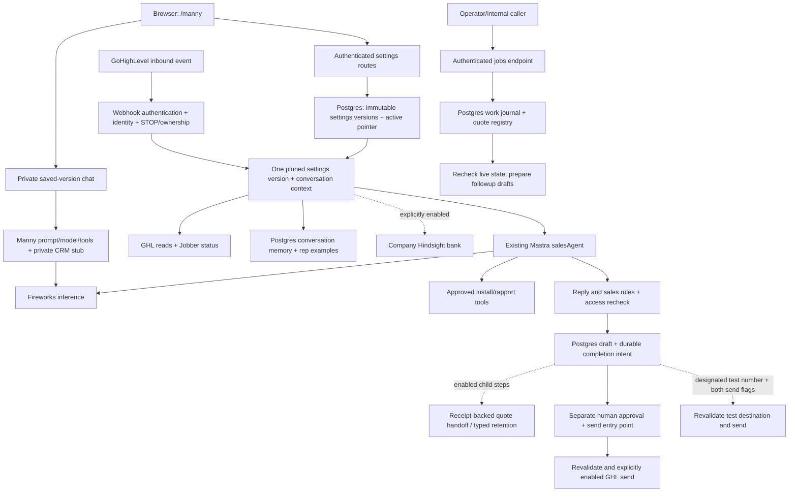

# Manny / Dynamite: complete context for another AI

This is the starting document for understanding this agent. It describes the inspected source, where its live state lives, how requests move through it, what must survive cleanup, and what is still unresolved. It is a public-safe guide to the system, not a dump of customer records, credentials or every private conversation.

**Alex's request, October 23, 2026:** “then make a complete context md in the local repo and update the public hermes copy too so he knows how everything is wired and what to preserve. dont change the live agent”. The earlier review-copy request was to let Hermes review and clean up a separate public copy while preserving everything in the live agent.

The documentation change that introduces this file does not change application code, saved settings, models, databases, providers, photos or customer-send behavior. The original development checkout is also the checkout serving the observed local `/manny` page; “original” does not mean every development feature is deployed to customers.

## Contents

1. [Read this first](#read-this-first)
2. [Repositories, addresses and evidence](#repositories-addresses-and-evidence)
3. [Architecture and source ownership](#architecture-and-source-ownership)
4. [Runtime entry points and request flows](#runtime-entry-points-and-request-flows)
5. [Manny's behavior, prompt, model and tools](#mannys-behavior-prompt-model-and-tools)
6. [Dashboard, settings and private testing](#dashboard-settings-and-private-testing)
7. [Storage, identity and recovery](#storage-identity-and-recovery)
8. [Photos and media](#photos-and-media)
9. [Integrations and their limits](#integrations-and-their-limits)
10. [Configuration inventory](#configuration-inventory)
11. [Training, evaluation and historical context](#training-evaluation-and-historical-context)
12. [Verification and safe development](#verification-and-safe-development)
13. [Known gaps and conflicting evidence](#known-gaps-and-conflicting-evidence)
14. [What Hermes must preserve](#what-hermes-must-preserve)
15. [How to finish a cleanup review](#how-to-finish-a-cleanup-review)
16. [Context outside Git and documentation maintenance](#context-outside-git-and-documentation-maintenance)

## Read this first

- **The existing agent is Manny, built with Mastra and Fireworks.** This repository is not a new replacement agent, the system-map dashboard, or the Hermes runtime itself.
- **Read the code and the dated operating runbook together.** The root README in the private repository dates much of its information to October 14. The October 22 runbook and Alex's later corrections supersede its model-selection rationale. The public README is a separate review orientation.
- **Preserve the current implementation while investigating.** Alex explicitly corrected the earlier model-selection approach: he wanted the last configuration he personally used, not whichever fine-tune was newest or had a reported score. That precise prior session/model remains unverified in the inspected artifacts.
- **Implementation is not activation proof.** A route, test, company ID, feature switch or successful offline fixture does not establish a hosted customer workflow, deployed fine-tune, database cutover or delivered message.
- **The public copy is independent.** It has no automatic synchronization back to the original agent. Its source was copied without private Git history, credentials, customer/review/billing logs, local databases, installed dependencies or generated build output.
- **Keep evidence gaps visible.** Laya is an unresolved required component. Do not invent its identity, replace it with a generic judge, assign it a zero score, or call it working.

## Repositories, addresses and evidence

| Item | Captured location or identity | What it means |
| --- | --- | --- |
| Original local checkout | `~/Documents/Codex/worktrees/dynamite-self-driving` on Alex's Mac | Existing development checkout; machine-local, not a portable path on Hermes |
| Private GitHub source | `increase-roas/sales-chatbot` | Original repository and private history |
| Inspected source branch | `feat/dynamite-self-driving` | Full development build; source revision is in this document's metadata |
| Development review | [Private draft PR #3](https://github.com/increase-roas/sales-chatbot/pull/3) | Changes against the original `main`; requires private access |
| Public review repository | [sales-chatbot-hermes](https://github.com/increase-roas/sales-chatbot-hermes) | Separate place for Hermes's review and cleanup |
| Initial public snapshot | `579d4b4d00824ab698b53c939d4b8ba05a40b71c` | Independent root commit; 124 retained original files plus README, handoff and provenance |
| Local Manny dashboard | `http://127.0.0.1:4111/manny` | Loopback on the machine running the server; the address will point at Hermes's own machine if opened there |
| Original documented hosted alias | `https://sales-chatbot-sigma.vercel.app` | Historical Vercel application address; do not infer current deployed revision or production parity from this document |
| System-map dashboard | `http://127.0.0.1:3201/explorer?view=local-files` | Separate application; its Review & fix feature is not part of Manny's runtime |

At the start of this documentation task, the original checkout had 207 tracked files and the captured source HEAD above. Its only untracked entry was the pre-existing `node_modules` dependency link. The source `main` ref was observed at `9334641ea2c4f220e46287f935f22686e1d376be`; this is a Git observation, not a fresh hosted-deployment readback.

The public repository's `COPY_PROVENANCE.json` records the original per-file hashes and intentional omissions. `HERMES_REVIEW.md` records the review request and preservation scope. Those two files exist in the public copy; private `reviews/` and `system/` evidence exists only in the original source. This context document is present in both repositories with the same public-safe contents.

## Architecture and source ownership

The installed lockfile records Mastra core `1.77.0`, CLI `1.34.1`, memory `1.37.1`, Postgres adapter `1.31.1`, observability `1.20.0`, Vercel deployer `1.2.36`, TypeScript `7.0.2`, and Zod `4.6.7`. `package.json` specifies compatible ranges; `package-lock.json` pins the captured install. Do not upgrade dependencies as an incidental part of cleanup.

Dashed links are conditional paths, not proof they are currently enabled. Normal customer inbound handling and the followup runner prepare drafts; they do not invoke the separate approved-send function automatically. The webhook also has an explicit real test-number send exception, described below. Private dashboard chat uses a different, deliberately limited testing path.

| System | Authoritative responsibility | Repository boundary |
| --- | --- | --- |
| GHL / GoHighLevel | Contacts, conversations, tags, tasks and CRM opportunity state | `src/mastra/ghl.ts`, webhook, lookup and send modules |
| Jobber | Quote state and actual quote records | `src/mastra/jobber.ts`; quote creation is not implemented in the concrete client |
| Postgres | Application settings, conversation history/storage, drafts, grades, control state and durable work | `index.ts`, `control-settings.ts`, `tables.ts`, `durable-work.ts`, followup registry |
| Fireworks | Selected model inference, embedding calls, provider-side fine-tune artifacts | Model selector, agent, example retrieval and historical scripts |
| Hindsight | Reusable company context and typed workflow observations | Company-specific runtime adapter; separate from desktop shared memory |
| Paperclip | External company identity and intended assignment ownership | Fixed company mapping exists here; an operational Paperclip task adapter is not established by this source |
| SigNoz | Intended stack-level operational evidence destination | Current `index.ts` registers Mastra's storage exporter; it does not itself establish a SigNoz exporter or delivered alert |
| Hermes | Reviewer of the independent public copy | No runtime dependency or automatic promotion mechanism |
| Codex / Claude / shared skills | Development and maintenance environment | Machine/global instructions are not the application, not distributed by this public repository |

## Runtime entry points and request flows

### Server boot

[`src/mastra/index.ts`](src/mastra/index.ts) constructs the Mastra instance, registers `salesAgent`, optional Postgres storage, observability, custom routes and the Vercel deployer. `DATABASE_URL` supplies the same database connection for Mastra storage and application records. The configured serverless pool has maximum 2 connections and a 10-second idle timeout. Semantic recall creates another bounded Postgres vector client in the agent module; do not assume the entire process has a single pool.

The server configures `SimpleAuth` from `MASTRA_API_TOKEN`; an unset token yields no accepted API token. Custom routes have the additional checks described below. Mastra's `/api` routes are its own API namespace. The application settings routes are registered under `/dynamite`, not `/api/dynamite`.

Current observability uses `MastraStorageExporter`. `/api/*` requests flush after handling; the webhook has its own flush path. The deployer allows 120 seconds; private model chat has an 80-second abort signal. These are source settings, not a service-level guarantee.

### Route map

| Method and path | Authentication / effect | Source |
| --- | --- | --- |
| `GET /manny` | Public HTML shell, no server credentials included | `control-panel.ts` |
| `GET /dynamite/settings` | Bearer token; reads settings/history/capabilities; store initialization may seed missing tables/baseline | `routes/control-settings.ts` |
| `POST /dynamite/settings/save` | Bearer; validates and saves a new inactive immutable version | Same |
| `POST /dynamite/settings/activate` | Bearer; atomic expected-active compare-and-set | Same |
| `POST /dynamite/settings/restore` | Bearer; makes a new inactive copy of an existing version | Same |
| `GET /dynamite/settings/photos/:photoId` | Bearer; approved known JPEG preview, no arbitrary file access | Same |
| `POST /dynamite/settings/chat` | Bearer + provider/enabled checks; paid private inference against a saved version | Same + `control-chat.ts` |
| `POST /webhooks/ghl/sms` | Custom `x-webhook-secret`; Mastra's normal bearer requirement is disabled for this webhook only | `routes/ghl-sms.ts` |
| `POST /dynamite/conversations/control` | Authenticated operator ownership control; STOP cannot be cleared by resuming bot ownership | `routes/conversation-control.ts` |
| `POST /dynamite/jobs` | Authenticated internal job invocation; actions below | `routes/sales-jobs.ts`, `sales-jobs.ts` |

The settings UI's access token stays in page memory, not URL parameters, browser persistent storage or saved settings versions. Error/timeout states must not claim a write succeeded before readback. Capability booleans describe configuration, not independently verified provider health.

### Inbound customer SMS to internal draft

1. Validate the webhook secret and incoming message/identity fields. Initialize the required application tables if needed.
2. Process STOP/unsubscribe before normal generation, persist opt-out/control state, and return without customer send. Normal drafting requires a contact ID and GHL message ID.
3. Look up an existing draft by GHL message ID. A duplicate reuses the saved draft and resumes unfinished completion work rather than creating duplicate external effects.
4. Resolve contact/phone identity and ownership; check GHL's authoritative contact and Jobber quote-stop evidence. Identity conflict, human takeover, opt-out or an approved quote must not become normal selling.
5. Resolve and pin one saved settings version for the entire request. Load prior Mastra conversation context. Determine address/deal stage and whether this is already past the quote pitch.
6. Build request context for deal state, prior photo IDs, speaker name, customer turns and lead identity. Optionally retrieve similar rep examples and, when explicitly enabled, company Hindsight context.
7. Generate through the existing agent and exact selected model. Extend the existing single system instruction with relevant reference blocks; do not split this Qwen setup into competing system messages.
8. Apply `guardReply` and `applySalesRules`, unless a terminal human/quote-acceptance path already owns the result. Suppress a model-selected image if the reply was materially rewritten. Recheck conversation access after generation.
9. Persist draft and completion intent together. Store only the resulting allowed photo/media identities. A provider outage is held/human work, not a fabricated normal draft.
10. Resume enabled receipt-backed child handoff/context-retention steps. Return draft/completion status. A draft, stored receipt or retention submission is not proof that a customer was contacted.

Authoritative implementation: [`routes/ghl-sms.ts`](src/mastra/routes/ghl-sms.ts), [`drafts.ts`](src/mastra/drafts.ts), [`draft-completion.ts`](src/mastra/draft-completion.ts).

### Designated test-number replies and inline ratings

This existing SMS testing path is separate from the browser-only dashboard tester. `BOT_TEST_PHONES` identifies designated test numbers. For one of those numbers, a fresh nonduplicate allowed sales draft can be sent for real only when both `GHL_TEST_SEND_ENABLED` and `GHL_SEND_ENABLED` are true. Immediately before sending, the webhook rereads the contact, rechecks access and known quote-approval stops, and verifies the payload phone exactly matches the authoritative GHL destination and designated test list. Its quote-stop check intentionally permits an unknown Jobber state for this designated-test path; ordinary approved customer sends fail closed on unknown state. Preserve that distinction rather than applying test behavior to customers.

For designated test-number messages, `👍`/`good` becomes an approve grade, `👎`/`bad` becomes reject, and `rate: <better text>` records an edited reply. The webhook records the rating against the latest draft in `sms_grades` and returns an HTTP rating acknowledgment without normal generation. `scripts/export-grades.ts` uses recorded human grades for training export; recording a grade is not an automatic fine-tune deployment. Actual test phone numbers and their message contents are private and are not included here.

Sources: [`test-mode.ts`](src/mastra/test-mode.ts), the rating and test-send branches in [`routes/ghl-sms.ts`](src/mastra/routes/ghl-sms.ts), and `tests/test-mode.test.ts`.

### Internal jobs and followups

`/dynamite/jobs` supports `status`, `work.resume`, `knowledge`, `followups.register` and `followups.run`. `status` can create missing database tables, so it is not a strictly read-only database health check. `knowledge` can make metered Hindsight calls when enabled.

`followups.register` takes an operator-verified contact ID, Jobber quote reference and sent timestamp. It does not discover a native Jobber quote-sent event. The current-state adapter checks GHL identity, replies, ownership, STOP and Jobber status before preparing due drafts. `followups.run` does not send those drafts to customers.

The captured default quote schedule is 24, 48, 96 and 168 hours after the verified sent time, with minimum 20 hours between followups and Detroit quiet time from 9pm to 9am. Newly registered quotes capture the active followup plan; existing work retains its saved plan. The global setting can pause processing. The separate personal-after-hours setting is a preview-helper setting, not an activated personal-followup worker. There is no recurring scheduler created by this repository's runtime entry point.

`work.resume` pages through unfinished draft-completion intents, with a bounded batch and `afterDraftId` cursor. It does not authorize replaying uncertain provider effects. Sources: [`sales-jobs.ts`](src/mastra/sales-jobs.ts), [`followup-runtime.ts`](src/mastra/followup-runtime.ts), [`followup-runner.ts`](src/mastra/followup-runner.ts), [`followups.ts`](src/mastra/followups.ts).

## Manny's behavior, prompt, model and tools

### Canonical instructions and sales rules

The exact baseline prompt is `SALES_INSTRUCTIONS` in [`agents/sales-agent.ts`](src/mastra/agents/sales-agent.ts). Read it before editing tone or training scripts; this guide summarizes it without creating a second prompt source.

- Manny represents Dynamite Lights in Michigan, doing holiday lighting installation, takedown and storage. If the thread already uses another representative name, keep that name.
- Short, casual, warm texts, usually about 20 words, with one easy specific question. No formal sign-offs, headings, lists or dash punctuation in customer replies.
- Aim for agreement to a free holiday-lights quote and then the address. Rooflines are the current focus. No wreath/garland upsell this season, even though historical install photos can depict them.
- Do not request a homeowner photo unless the homeowner says the mockup is wrong. After yes + address, the intended handoff is mockup/quote preparation and Marvin following up.
- Do not invent a price, discount, deposit, date, crew time or booking. Deal tools enforce their stage boundaries and do not themselves create a real quote/booking.
- Existing handling of machine-identity questions routes toward a human; do not silently change this behavior as part of structural cleanup. Preserve the source/test contract and surface any proposed behavior change separately.
- Install photos support an undecided lead; skip them after agreement, during scheduling or an unhappy/money-sensitive exchange. Rapport photos are rare and speaker-aware.

[`sales-rules.ts`](src/mastra/sales-rules.ts) and [`guard.ts`](src/mastra/guard.ts) enforce parts of this after generation. `pastQuote` considers customer assertions, not representative text, negations or hypothetical questions. `quoteApprovedStop` stops for approved/converted Jobber quotes, stop tags or approved pipeline state; sends additionally stop when Jobber state is unknown.

The rule modules and the model prompt are different layers. A prompt sentence is not proof a provider write happens. A code rewrite is not permission to remove the user-visible behavior it protects.

### Model identity and unresolved historical selection

[`sales-model.ts`](src/mastra/sales-model.ts) preserves `accounts/fireworks/models/qwen3p8-2p4t-a95b` as the code default. `FIREWORKS_SALES_MODEL` seeds a baseline; an existing saved active version can choose a different exact resource. `resolveSalesModel` adds the Mastra `fireworks-ai/` provider prefix, without silently substituting another model if an explicit selection fails.

The documented candidate is `accounts/abloomster/models/dynamite-sales-qwen27b-v3c`. The October 22 account inspection recorded completed/ready training and no serving deployment reference. That is historical metadata, not a fresh provider inspection or proof of an inference endpoint. Earlier scores are disputed and are not the selection rule. Do not choose v1, v3c or the base model merely by interpreting an old score or taking the newest name.

Laya/ Layla references are part of the unresolved history. The current capabilities explicitly report the required artifact/invocation as unavailable. The three implemented deterministic scorers are not Laya.

### Six tool contracts

| Tool | Purpose | Boundary to preserve |
| --- | --- | --- |
| `lookupProspect` | Read a GHL contact/opportunities from a phone identity | Missing configuration is not a successful live lookup; private dashboard chat substitutes an explicit local test stub |
| `quotePrice` | Check the allowed deal stage before price discussion | Does not calculate or create an authoritative real Jobber price |
| `proposeDate` | Check scheduling discussion is allowed | Does not establish availability or a real install appointment |
| `bookInstall` | Check booking discussion is allowed | Does not book a crew merely because a model called it |
| `showInstallPhoto` | Pick an eligible approved install photo | Respect settings, consent, no-repeat aliases, stage and customer context |
| `showRapportPhoto` | Pick a rare approved personal/rapport photo | Preserve speaker identity, cadence and no-repeat behavior |

Read [`tools/deal-tools.ts`](src/mastra/tools/deal-tools.ts), [`tools/lookup-prospect.ts`](src/mastra/tools/lookup-prospect.ts), [`tools/show-photo.ts`](src/mastra/tools/show-photo.ts) and [`tools/show-rapport.ts`](src/mastra/tools/show-rapport.ts) for exact schemas/results. Stages are `NEW`, `QUALIFIED`, `CONFIRMED`, `ESTIMATE_SENT` in [`deal-state.ts`](src/mastra/deal-state.ts). Preserve evidence-based transitions; do not infer payment, approval or booking from a loose keyword.

## Dashboard, settings and private testing

[`control-panel.ts`](src/mastra/control-panel.ts) contains the native HTML/CSS/browser UI. [`control-settings.ts`](src/mastra/control-settings.ts) owns the strict Zod schema, canonical settings hash, persisted version store and request pinning. [`routes/control-settings.ts`](src/mastra/routes/control-settings.ts) owns HTTP validation, authentication, protected photo previews and provider errors.

### Complete settings groups

| Group | Fields |
| --- | --- |
| Model and instructions | `modelId`, `instructions` |
| Generation | `temperature`, `topP`, `maxOutputTokens`, `maxSteps` |
| Tools | The six named tool enable booleans above |
| Photos | `installEnabled`, `rapportEnabled`, `disabledIds`, per-ID caption `overrides` |
| Followups | `enabled`, `spacingHours`, `minimumGapHours`, `lines`, `quietStart`, `quietEnd`, `timeZone`, `personalAfterHours`, `callCooldownMinutes` |
| Memory/examples | `lastMessages`, `workingMemoryEnabled`, `workingMemoryTemplate`, `semanticRecallEnabled`, `recallTopK`, `recallMessageRange`, `repExamplesEnabled`, `repExamplesCount` |
| Hindsight | `enabled`, fixed `bankId`, up to three `pageIds` |
| Evaluation | `sampleRate` |

Code defaults include `maxSteps:5`; null model sampling/output fields mean use provider defaults; all six tools and both photo categories enabled; last 20 messages; working memory enabled; semantic recall conditional on a database connection; top 3 recall results with message range 2; up to 5 rep examples; scorer sampling 1. These are baseline defaults, not a fresh read of the current active database version.

### Version semantics

1. Storage initialization attempts to insert a hash-identified baseline with conflict-ignore semantics, then seeds the active pointer only if it is absent. An already active version is never overwritten by this initialization. A changed code baseline may add an inactive baseline row on later initialization. Its label is “Current preserved setup”, not a claim that the last-used configuration was recovered.
2. **Save** creates a new inactive UUID version. It must not change the active version.
3. **Use this version** updates the active pointer only if the caller's `expectedActiveId` still matches. Concurrent edits yield 409 rather than overwriting another activation.
4. **Restore** clones an old version into a new inactive version. It is not destructive history rollback or automatic activation.
5. Every hook within a request uses the same pinned version: prompt, model, generation, tools, memory and scorers. User-supplied request-context fields are not trusted version authority.
6. Missing/unready storage produces an explicit failure, not an in-memory imitation of a durable save. The storage readiness helper must be awaited before accessing Mastra storage.

Credentials, database connection strings and send activation are not saved as editable version content. A boolean setting cannot override the existing server-side activation requirement. Preserve disconnected/loading/editing/saved/active/error/conflict states and the actual UI appearance, including narrow layouts.

### Private “Test Manny” chat

This path loads a selected saved version, even if inactive. Unsaved edits first need a save/reset. Browser history is sent with each request; version switching starts a new local conversation. The response identifies the model/version, tool calls, selected photo and handoff state. Approved previews use authenticated JPEG requests.

It uses the same prompt, generation options, enabled six-tool set and relevant post-generation rules, but `lookupProspect` is a private-test stub. It does not retrieve/write shared customer conversation memory, rep examples or Hindsight, run followups, create CRM effects, send SMS, or grade a live customer interaction. A good dashboard reply is not end-to-end customer-workflow proof.

Real chat requires the existing Fireworks key and `MANNY_CHAT_ENABLED=true`; it consumes credits. The flag is not a dollar-budget enforcement system. Do not inherit an old chat approval as a new spending grant. The source keeps failed messages for manual retry, reports missing storage/provider configuration and sanitizes provider failures. A timeout can still consume credits. Inputs/history and returned history are bounded; shortening is labeled.

Authoritative contract: [`docs/manny-control-panel.md`](docs/manny-control-panel.md), [`control-chat.ts`](src/mastra/control-chat.ts).

## Storage, identity and recovery

### Data map

| Storage | Key identity / contents | Preservation requirement |
| --- | --- | --- |
| Mastra-managed tables/vector storage | Agent threads, messages, working memory, traces and semantic memory as configured | Preserve provider/storage interfaces and resource/thread identity; rows are not in Git |
| `manny_settings_versions` | Immutable full settings JSON, ID, label, creation time, content hash | Preserve version contents/history; no credential values |
| `manny_settings_active` | Singleton pointer to a saved version | Preserve atomic activation/conflict semantics |
| `sms_conversation_control` | Contact ID, owner, stopped flag, identity hold | Human takeover and STOP survive restart |
| `sms_phone_aliases` | Canonical phone to contact ID | A collision must hold work, not silently transfer history to a different customer |
| `sms_opt_outs` | Phone-based opt-out | Preserve normalization and earlier stored formats |
| `sms_drafts` | UUID, unique GHL message ID, contact/phone, inbound/reply, rules/stage, media and completion intent | Replay reuses draft identity; parent intent is saved with draft |
| `sms_grades` | Human grade/edit linked to a draft | Keep actual human judgments separate from machine scorer output |
| `rep_examples` | Historical representative/customer examples and vectors | Private customer-derived data, not a public fixture or source of authoritative prices/dates |
| `durable_sales_work` | Unique source key, kind, contact, payload, due time, state, receipt | Preserve idempotency, pending-only claim and uncertainty handling |
| `sales_followup_quotes` | Verified quote reference/time and saved scheduling plan | Preserve native quote identity and do not recreate old queues from defaults |

Schema comes from both the two committed SQL migrations under `supabase/migrations/` and runtime `CREATE TABLE IF NOT EXISTS` / additive schema setup in application modules. The historical folder name does not prove the current deployed database is Supabase or that migrating those two SQL files alone reconstructs all runtime tables.

The agent's normal SMS memory uses a verified resource identity and a thread derived as `sms-${resource}`. Phone normalization, contact ID matching and immutable alias collision behavior prevent cross-customer context. Do not replace these identities with random IDs during cleanup or collapse all leads into a shared chat.

### Durable effect lifecycle

`pending` work can be atomically claimed into `dispatching`. Only an owned dispatch can be completed. `completed` requires an effect/draft receipt; it does not mean customer delivery. `uncertain` means the provider or durable write outcome needs reconciliation. `cancelled` is terminal for that work.

The effect wrapper records stable source keys. A known-not-sent failure can be retryable. Missing/ambiguous provider acknowledgment becomes uncertain. Failure to save a receipt after a dispatch must not trigger a blind resend. An interrupted dispatch needs an operator to establish the old worker is inactive and read authoritative state before quarantine/recovery. Never bulk-reset `dispatching` or `uncertain` rows to `pending`.

Completion intents are inserted alongside drafts so a crash after draft persistence still leaves discoverable work. Duplicate inbound processing and `work.resume` can continue child steps without repeating their completed receipts. STOP/human takeover is rechecked around effects. Missing enabled dependencies remain held, not falsely completed.

Read [`conversation-control.ts`](src/mastra/conversation-control.ts), [`draft-completion.ts`](src/mastra/draft-completion.ts), [`durable-work.ts`](src/mastra/durable-work.ts) and their tests before altering recovery.

## Photos and media

[`photo-library.ts`](src/mastra/photo-library.ts) is the metadata source of truth. [`photo-assets.ts`](src/mastra/photo-assets.ts) embeds the approved JPEG bytes so the dashboard does not depend on original private photo folders. [`photos.ts`](src/mastra/photos.ts) handles eligibility, captions, settings, media limits and duplicate aliases. Do not decode/re-encode assets as an incidental formatting step.

The preserved bundle contains 10 install entries and 2 rapport entries. `rooftop-07` and `rooftop-high-14` represent the same image for no-repeat purposes. Asset identity is not simply filename equality. Existing consent notes say Alex approved these send-safe images and house numbers/plates were blurred; this context task did not perform a new visual privacy audit or collect new consent.

Runtime dashboard previews use embedded bytes by default. `MANNY_PHOTO_DIR` is an optional machine-local override; the protected route only resolves known JPEG filenames. Actual customer attachments use a per-photo URL or `PHOTO_BASE_URL`; having a bundled preview does not establish an externally reachable SMS media URL.

Preserve ID-to-file mapping, exact bundled bytes, consent, aliases, captions, sender/representative identity, enable/disable choices and no-repeat logic. Historical photographed wreaths do not change the current no-wreath sales offer. `tests/photo-portability.test.ts` contains the byte-level preservation oracle; `tests/photos.test.ts` covers selection logic.

## Integrations and their limits

### GHL, Jobber and Marvin handoff

GHL client configuration uses `GHL_API_KEY` and `GHL_LOCATION_ID`. Inbound events use the separate webhook secret. Prospect lookup, recent calls, contact/phone verification, tags and task creation are distinct operations with different consequences.

The intended quote-request handoff is: quote-requested tag, Jobber quote, Marvin task with the quote/mockup instructions. [`quote-flow.ts`](src/mastra/quote-flow.ts) runs enabled steps in order with stable receipts and access rechecks. `FLOW_TAG`, `FLOW_JOBBER_QUOTE` and `FLOW_MARVIN_TASK` are separate switches. They default false in the environment template; their actual runtime values were not exported for this document.

The concrete Jobber client's `createQuote()` currently throws an explicit not-implemented error. Quote-status GraphQL fields/version are labeled unverified in source; current lookup is by phone, not a proven match to the registered quote reference. The sent-quote acceptance path also records that the client-hub link field is unverified. Do not enable the switches and call quote creation operational without native API/schema and readback evidence. Do not reuse another application's rotating Jobber grant.

`sendApprovedDraft` is a separate entry point: require an approve grade, revalidate contact/phone, ownership and quote-stop state, then call the explicitly enabled GHL send function. Preserve the distinction between recorded approval and actual provider send/delivery. `scripts/send-approved.ts` and pipeline scripts are not harmless baseline-check commands.

### Hindsight and Paperclip

The fixed customer company ID is `f63a396b-956e-42ca-9916-88d98f4a54fe`; the runtime bank must be `paperclip::f63a396b-956e-42ca-9916-88d98f4a54fe`. Older external notes call this existing company Powersports Launch; the scoped October 22 stack update identifies it as Dynamite Lights. One company bank is shared across the intended customer roles, not a bank per role.

This customer runtime bank is different from the desktop agents' shared `alex-agents` bank. Global developer memory via Composio does not prove Manny's bank-scoped runtime transport works. The app uses its explicit HTTP transport in `hindsight-transport.ts`, verifies the key lists exactly the intended bank, then lists/reads configured knowledge pages and performs bounded recall. Both the environment activation and selected settings must permit context use.

Retrieved text is historical reference data, not instructions or authorization. Enabled context failure holds the sales reply. After a successful draft, typed retention contains fixed fields such as event/outcome/deal-state/photo-use, not arbitrary customer transcripts. An operation ID proves submission acknowledgment, not consolidation or successful learning.

The intended learning loop is work A → typed retention → consolidation/approved knowledge-page refresh → work B benefiting from the updated source. Page provisioning, automatic refresh and that hosted loop remain unproved in the runbook. The vendor role documents and bank template under `vendor/self-driving-agents/` are pinned reference material, not an installed Mastra/Paperclip orchestration runtime.

Paperclip company/assignment ownership remains external. This repository does not provision a team, assign a scheduler or demonstrate a hosted Paperclip job completing through the real runtime account.

### Database hosting and observability

The original README documents Supabase wiring from October 14. The newer runbook names Neon project `twilight-glade-11976094` as the proposed target and explicitly says no deployed `DATABASE_URL` cutover was done by that build. Local dashboard tests used a separate local PostgreSQL database. A local successful save does not prove a hosted migration or production state.

The source currently registers Mastra storage observability, not an explicit SigNoz transport. The stack-level runbook names SigNoz as the destination, but traces arriving there and alerts reaching Alex require their own evidence. A dashboard availability check is not alert-delivery proof.

## Configuration inventory

These are names and meanings, not credential values. `.env.example` is the tracked starting inventory; actual values belong in the existing private secret/runtime configuration. The local checkout did not contain `.env` or `.env.local` when this document was prepared; that does not prove the running process lacks injected configuration.

| Name | Used for | Capture interpretation |
| --- | --- | --- |
| `FIREWORKS_API_KEY` | Real model inference and embeddings | Secret; not copied/exported |
| `FIREWORKS_SALES_MODEL` | Exact baseline model resource | Saved active settings can supersede the baseline |
| `MASTRA_API_TOKEN` | Authenticated workspace/API access | Secret; no token in browser persistent state or saved versions |
| `DATABASE_URL` | Mastra and application Postgres | Secret; do not infer host identity from a folder name |
| `GHL_WEBHOOK_SECRET` | Inbound webhook authentication | Separate from workspace bearer |
| `GHL_API_KEY`, `GHL_LOCATION_ID` | GHL account/location calls | Existing route and identity must remain exact |
| `JOBBER_ACCESS_TOKEN` | Bot-specific Jobber OAuth grant | Do not borrow another app's token |
| `GHL_SEND_ENABLED` | Explicit customer-send activation | Template false; actual running value not captured here |
| `GHL_TEST_SEND_ENABLED`, `BOT_TEST_PHONES` | Designated test-send handling | A test destination/config flag is not a new send approval |
| `FLOW_TAG`, `FLOW_JOBBER_QUOTE`, `FLOW_MARVIN_TASK` | External quote-handoff effects | Template false; code shipping is separate from activation |
| `PHOTO_BASE_URL` | Externally reachable customer-media base | Does not control the embedded authenticated dashboard preview |
| `MANNY_PHOTO_DIR` | Optional approved local JPEG override | Source-supported; not listed in the current template |
| `HINDSIGHT_ENABLED` | Runtime context activation | Requires matching selected settings and exact company/bank |
| `PAPERCLIP_COMPANY_ID`, `HINDSIGHT_BANK_ID` | Fixed customer identity | Non-secret identity; values above |
| `HINDSIGHT_API_KEY` | Bank-scoped runtime key | Secret; desktop shared key is not a fallback |
| `HINDSIGHT_PAGE_IDS` | Up to three configured existing pages | No page IDs or contents provisioned by this documentation task |
| `MANNY_CHAT_ENABLED` | Paid private dashboard testing | Template false; not itself a spending cap |
| `VERCEL_ENV` | Runtime environment labeling | Hosting environment; not proof of a release |

Historical `SUPABASE_URL` / `SUPABASE_ANON_KEY` references in the root README describe earlier deployment setup. The inspected server and current template use `DATABASE_URL` for Postgres. Inspect actual deployment configuration privately before removing any old hosting variable; this task did not change one.

## Training, evaluation and historical context

### Retained artifacts

- `scripts/build-sft.py`, `optimize-sft.py`, `build-dpo.py`, `sft_patterns.py`: historical dataset construction/optimization. `optimize-sft.py` extracts the exact `SALES_INSTRUCTIONS` string from the agent file; keep that parser dependency in mind before moving the prompt.
- `scripts/round50-to-training.py`: converts Alex's YES/NO review ratings into training inputs. Its raw items/ratings are private external inputs, not included merely because the converter exists.
- `scripts/fw.py`, `fw-guard.ts`, `fw_guard.py`, `fw-billing.py`: provider/billing/training helpers. Some operations can incur costs or mutate provider state. Do not execute them as generic setup commands.
- `scripts/eval-agent.ts`: model evaluation path records model/prompt/tool/config metadata. Synthetic comparison does not establish production memory/retrieval parity.
- `scripts/judge-*.py`, `buyer-signals.py`, `followup-timing.py`, `playbook.py`, `export-grades.ts`: historical analysis/evaluation helpers. Source existence is not current model-quality evidence.
- `prompts/served-v3.txt`: retained historical served prompt artifact. The current baseline source is `SALES_INSTRUCTIONS`, and active saved instructions are database state.

### Historical private evidence

The original `reviews/` directory contains October 14–15 dataset, voice, photo, flow, signal, billing and independent-review artifacts. `system/lessons.md` and `system/run-log.md` preserve operator history. They remain in the private local repository/history and were intentionally excluded from the public copy.

Those artifacts can explain why a behavior exists, but old review scores do not select the current model. The October 22 owner correction supersedes the previous ranking rationale. A recovered past transcript must be bound to the exact prompt/model/settings/tool version before being described as Alex's last-used setup.

Machine-local history evidence for that correction: Codex session `01a1620d-b8bd-7433-b4bb-c426ed027565`, user event around `2026-10-22T17:32:31Z`: “the scores were wrong. i wanted the one that was the last one i used. is there a dashboard i can see all of the settings and easily change?” Raw session files are not included publicly.

The current deterministic Mastra scorers are style, stage transition and premature payment in [`scorers.ts`](src/mastra/scorers.ts). They are not a recovered Laya evaluation. Human grades in `sms_grades` are a separate signal; do not fabricate approvals/grades to make calibration look complete.

## Verification and safe development

### What has evidence

- **Source-copy evidence, October 23:** the initial public copy retained 124 original files byte-for-byte, including the 12 approved photo entries/assets. Public provenance records the source revision and hashes. No private history was imported.
- **Captured copy check, October 23:** `npm test` passed 166 tests with zero failures and zero skips using an isolated HOME/TMPDIR, no inherited provider/database credentials and the installed dependency tree. This is captured test evidence from snapshot creation, not a claim that tests were rerun for this documentation edit.
- **Local dashboard evidence, October 22, as recorded in the operating docs:** real local PostgreSQL save/activate/restart/restore and private saved-version chat tests, plus TypeScript/build and browser walkthroughs. One separately approved real preserved-model reply and its approved photo were displayed. Hosted Neon migration, v3c serving, last-personal-use identity and Laya were not established by that test.
- **Documentation inspection, October 23:** source modules, manifests, configuration names, routes, database schema definitions and historical decision references were read without altering runtime behavior. No new paid inference, customer send, database write, migration or production release is implied.

### Commands and their actual scope

| Command | What it does / caveat |
| --- | --- |
| `npm ci` | Installs lockfile dependencies; inspect package scripts and use an isolated review checkout |
| `npm test` | Runs `node --test tests/*.test.ts`; does not automatically run the Python tests |
| `npm run typecheck` | TypeScript static validation |
| `npm run build` | Mastra production build; generated output is not a deployment |
| `npm run dev` | Starts a real server; imports runtime configuration; not a harmless read-only check |
| `npm run check:gates` | Existing adversarial reply/stage checks; inspect its provider/setup requirements first |
| `npm run export:grades` | Reads existing human grades with configured environment; customer-derived output stays private |

The real-Postgres acceptance test in `tests/postgres-integration.test.ts` creates its own temporary Unix-socket cluster when `initdb`, `pg_ctl` and the installed driver exist. It explicitly avoids a supplied application `DATABASE_URL`; missing prerequisites can produce a skip. Other tests also own their fixtures. Do not point tests or review tooling at the live database as a substitute for missing local prerequisites.

Important test homes: `bot-preservation.test.ts`, `photo-portability.test.ts`, `photos.test.ts`, `control-settings.test.ts`, `control-panel-credentials.test.ts`, `conversation-control.test.ts`, `durable-work.test.ts`, `webhook-completion.test.ts`, `followup-runtime.test.ts`, `ghl-send.test.ts`, `sales-model.test.ts` and `postgres-integration.test.ts`. Read assertions before removing a path that looks unused; dynamic tool/settings hooks can make static call-site scans misleading.

## Known gaps and conflicting evidence

| Topic | Confirmed source/documentation state | What still needs proof |
| --- | --- | --- |
| Last personally used configuration | Owner prefers it over score/newness; code labels current setup preserved | Exact prior session/model/prompt/tool/settings binding |
| v3c fine-tune | Historical training READY/COMPLETED; candidate ID preserved | Current serving endpoint, tool compatibility, bounded approved evaluation, deliberate selection |
| Laya | Capabilities explicitly say artifact/invocation unavailable | Real artifact/version/endpoint and an evaluation receipt |
| Jobber quote creation | Concrete `createQuote` throws not implemented | Native verified grant/schema/create/readback workflow |
| Jobber quote status | Phone-based, source labels GraphQL fields/version unverified | Exact live schema and quote-ID ownership mapping |
| Hosted Hindsight loop | Adapter implemented; existing company/bank documented | Runtime bank key/pages, activation, retention/consolidation/refresh and later-job evidence |
| Paperclip execution | Company identity and intended ownership documented | Actual assigned hosted job through the intended runtime account |
| Neon cutover | Proposed target documented; no cutover performed by development build | Restore rehearsal, full schema/data parity and authorized deployed connection change |
| Followup automation | Registration/runner prepare durable drafts | Native quote-sent event, intended scheduler, delivery and operational ownership |
| Personal followups | Saved preview-helper timing | Actual worker/activation; do not present as currently scheduled |
| SigNoz | Intended stack destination; code uses Mastra storage exporter | Actual telemetry transport/arrival and alert delivery |
| Customer auto-send/A2P | Separate explicit send path; older notes say registration not verified | Current registration, approved pilot, real recipient/provider/delivery proof |
| Current database settings | Store/schema inspected | Actual active version was not exported or changed during this task |
| Root README vs newer docs | Old README contains historical scores, DB and setup assumptions | Use source and later corrections; do not treat old deployment prose as fresh readback |

These are documented boundaries, not a request to enable every component or fix live production during a cleanup review. Statuses must remain explicit until evidence changes them.

## What Hermes must preserve

Alex's requested cleanup is behavior-preserving work in the separate public review repository. The receiving AI should preserve these contracts and make any intended behavior change visible for review:

1. **Identity and voice:** Manny's existing instructions, representative-name continuity, roofline offer, address/quote progression, humor and human handoff handling.
2. **Exact model selection:** retain current saved model behavior and explicit-ID failure semantics. No silent “upgrade”, score-based replacement, fallback or fabricated restoration of a last-used model.
3. **All six tools:** schema, result shape, dynamic enable switches, stage evidence and photo behavior. Do not delete dynamic registrations because a text search appears to find no call.
4. **Dashboard appearance and states:** settings fields, mobile/desktop layout, saved-version chat, loading/error behavior and clear inactive/active identities.
5. **Version semantics:** immutable save, expected-active atomic use, inactive restore and one pinned snapshot throughout each request. Preserve database history.
6. **Original approved photos:** exact bytes, stable IDs, captions, aliases, consent, speaker constraints, no-repeat behavior and authenticated previews. Avoid replacing the library with placeholders.
7. **Customer state and ownership:** contact/phone identity, thread/resource binding, opt-outs, STOP, human takeover, approved-quote stop and live access rechecks.
8. **Drafts, grades and send separation:** real human approval stays separate from machine scoring; ordinary webhook/followup draft creation must not become automatic customer sending. Preserve the separately configured designated-test-number reply/rating path and its stricter destination matching without extending it to customers.
9. **Durable work:** stable source keys, claim ownership, receipts, cursor progress, resumability and reconciliation of ambiguous effects. Do not wipe queues to simplify recovery.
10. **Data/source ownership:** GHL owns CRM, Jobber owns quote state, Postgres owns app/work records, Hindsight supplies historical company reference, and Paperclip owns external assignments. Do not add parallel substitutes or memory banks for convenience.
11. **Historical artifacts and training lineage:** preserve converters and relevant source evidence; private input data stays private. Moving prompt text must account for its training parser.
12. **Honest limits:** keep Laya, last-use identity, incomplete Jobber/Hindsight/Paperclip/Neon/SigNoz activation and live-delivery gaps visible. A successful refactor cannot turn missing external evidence into a pass.

## How to finish a cleanup review

The following is the documentation author's suggested review sequence, not permission to deploy, spend, contact anyone or migrate data:

1. Read this file, the two operating contracts under `docs/`, then the named source/test owners. In the public repo also read `HERMES_REVIEW.md` and `COPY_PROVENANCE.json`.
2. Record the review base commit and existing state. Identify a concrete problem with source/test evidence before choosing a fix. For claims dependent on current external APIs/libraries, research the installed version against primary vendor documentation first; distinguish source-backed transformations from external assumptions.
3. Propose scoped changes and the exact behaviors that remain equivalent. Compare UI states/screenshots where appearance is affected. Do not merge unrelated model, provider, activation or dependency changes into cleanup.
4. Test the relevant layers using synthetic data and disposable local resources. Report executed tests, prerequisites/skips and gaps honestly. Do not weaken assertions merely to make a refactor pass.
5. Return a branch/PR in the public review repository with findings, before/after behavior, preservation evidence and unresolved items. The private source and live runtime remain separate.
6. Any later promotion into the original requires review of the exact diff, data compatibility and deployment implications. There is no automatic sync or merge-back. Old spending or send approvals in historical files do not grant a new action.

## Context outside Git and documentation maintenance

| Context | Where it lives | How a future authorized review should handle it |
| --- | --- | --- |
| Current active settings and version history | Configured Postgres tables | Read through the authenticated settings boundary; record version/hash privately; do not activate or seed a different live database |
| Customer messages, drafts, grades, photo history and work receipts | Mastra/application Postgres and CRM | Use minimal authorized private evidence; do not export into the public repository |
| Hindsight company pages and memory | The fixed company bank | Inspect via the approved bank-scoped route when authorized; do not substitute the global bank |
| Private model artifacts/datasets/provider deployment | Fireworks account and private input files | Identify exact resource/version and provenance; no assumed local copy or free evaluation |
| Credentials and hosted environment | Existing secret manager/runtime/hosting configuration | Keep out of Markdown, Git, screenshots and logs; configuration presence is distinct from working provider proof |
| Prior development conversations | Alex's local Codex/Claude/Cursor history | Search targeted history and cite session/event identity; context is not a new approval |
| Global rules, hooks and skills | Machine-owned `~/.agents`, `~/.codex`, `~/.claude` and installed runtimes | Not bundled application dependencies; do not rewrite them as part of this agent cleanup |
| Wider stack state | Machine-local `~/AGENT-CONTEXT.md` and `~/Projects/stack-config/docs/BUILD-REFERENCE.md` | Private scoped context; older global counts may be superseded by dated updates |
| Private audit/training/review records | Original repository `reviews/`, `system/` and private datasets | Available to authorized local/private review only; public omissions are intentional |

This document makes those dependencies visible rather than pretending a Git checkout contains their live contents. It intentionally includes no credentials, raw customer transcripts, database dump or current active-settings export.

When a later authorized change alters wiring, behavior, activation state or authoritative ownership, update this document with its source revision and dated evidence, plus the appropriate operating contract. Update the public copy only with public-safe context. Keep code/prompt/schema as the authoritative implementation rather than copying them into a second competing source. Historical records should remain dated history.

Primary source index: [`src/mastra/index.ts`](src/mastra/index.ts), [`agents/sales-agent.ts`](src/mastra/agents/sales-agent.ts), [`control-settings.ts`](src/mastra/control-settings.ts), [`routes/`](src/mastra/routes/), [`docs/dynamite-self-driving.md`](docs/dynamite-self-driving.md), [`docs/manny-control-panel.md`](docs/manny-control-panel.md), [`package.json`](package.json), [`package-lock.json`](package-lock.json), [`.env.example`](.env.example), [`tests/`](tests/).
